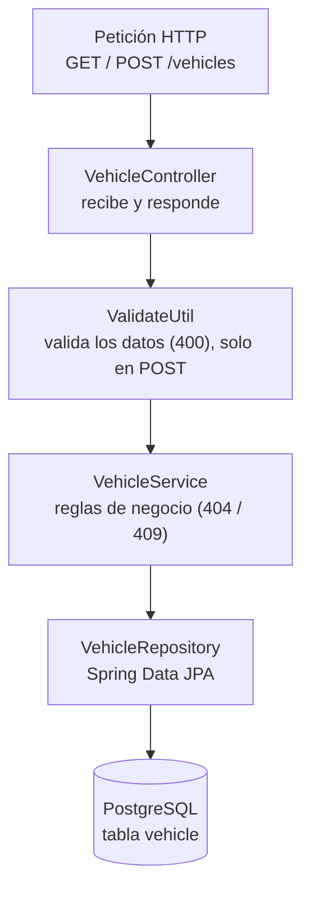
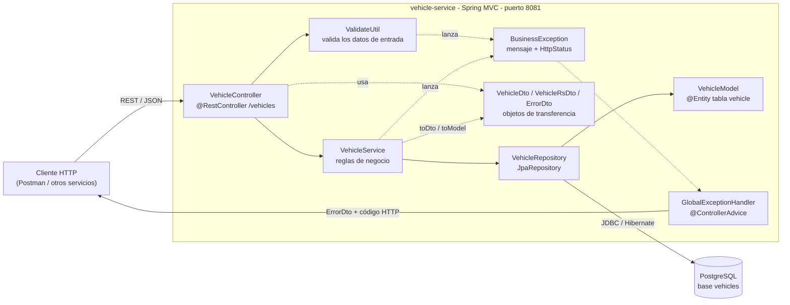
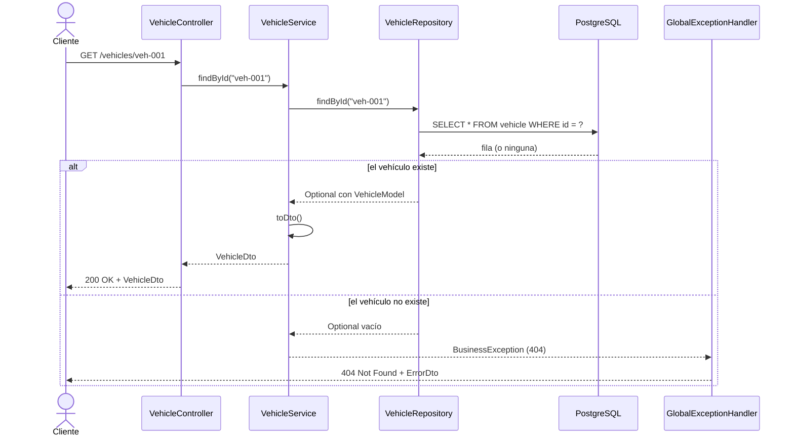
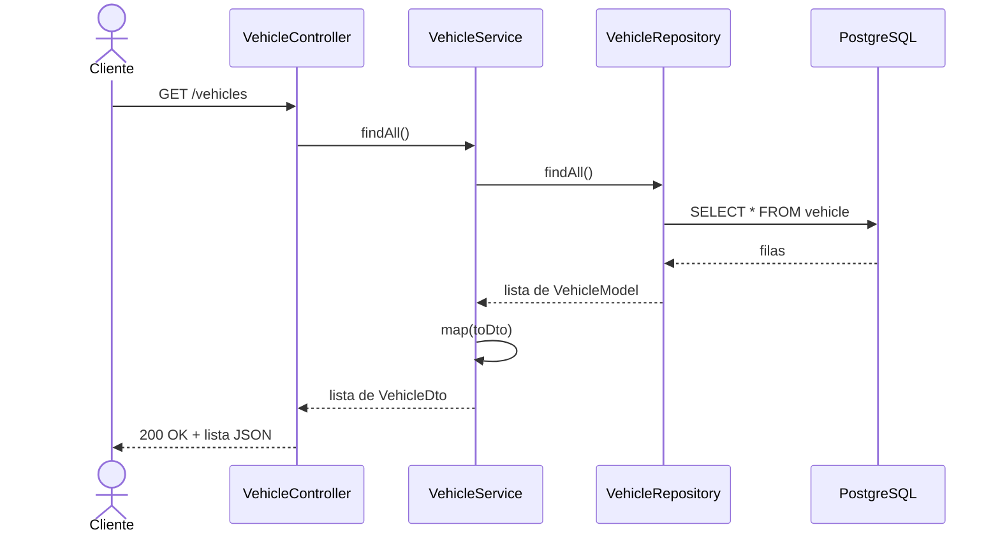
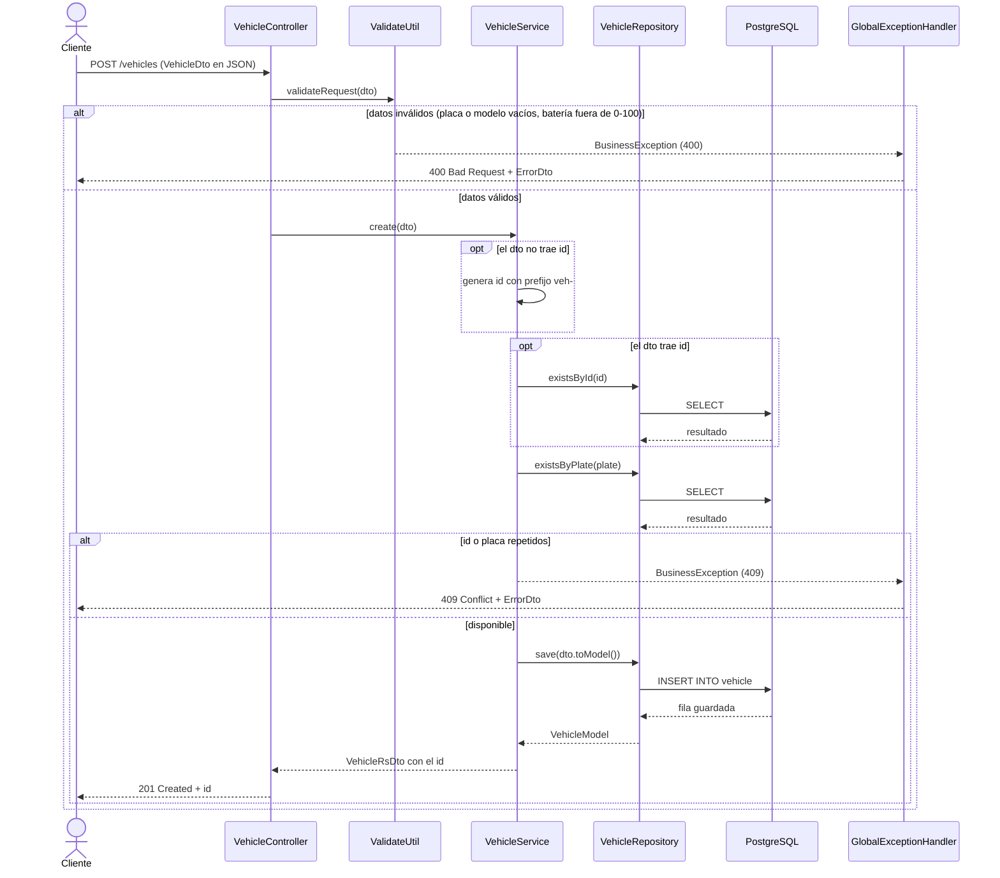

# vehicle-service

Microservicio A del sistema de trazabilidad y perfil de flota. Administra el catálogo de
vehículos: datos técnicos, estado del motor, última ubicación registrada y fecha de mantenimiento.

- **Stack:** Java 21, Spring Boot 4.1.1 (Spring MVC), Spring Data JPA, Lombok
- **Base de datos:** PostgreSQL, base `vehicles` (una base de datos por microservicio)
- **Puerto:** `8081`

## Arquitectura

Arquitectura por capas de `vehicle-service`. Tiene su propia base de datos PostgreSQL y no depende
de ningún otro microservicio.



## API

| Método | Ruta | Descripción | Respuestas |
|---|---|---|---|
| `GET` | `/vehicles` | Lista todos los vehículos | `200` |
| `GET` | `/vehicles/{id}` | Devuelve un vehículo por id | `200`, `404` |
| `POST` | `/vehicles` | Crea un vehículo. El `id` es opcional: si falta se genera uno con formato `veh-xxxxxxxx` | `201` `{ "id": "..." }`, `400`, `409` |

Los errores de negocio se devuelven con esta forma:

```json
{ "message": "Vehicle not found: veh-999", "httpStatus": "NOT_FOUND" }
```

Ejemplo de vehículo:

```json
{
  "id": "veh-001",
  "plate": "ABC-1234",
  "model": "EcoTruck EV",
  "batteryStatusPercentage": 84.5,
  "engineStatus": "OK",
  "lastLatitude": 28.6353,
  "lastLongitude": -106.0889,
  "lastMaintenanceDate": "2026-09-01"
}
```

Reglas de validación y de negocio:

| Regla | Código |
|---|---|
| `plate` y `model` no pueden venir vacíos | `400` |
| `batteryStatusPercentage` debe estar entre 0 y 100 | `400` |
| Ya existe un vehículo con ese `id` | `409` |
| Ya existe un vehículo con esa `plate` | `409` |
| El vehículo solicitado no existe | `404` |

## Cómo ejecutarlo

1. Crea la base de datos en PostgreSQL:

   ```sql
   CREATE DATABASE vehicles;
   ```

2. Crea un archivo `local.properties` en la raíz del proyecto (junto al `pom.xml`) con tu contraseña de PostgreSQL. Este archivo está en `.gitignore` y no se sube al repositorio:

   ```properties
   spring.datasource.password=TU_CONTRASEÑA
   ```

   Por defecto se usa el usuario `postgres` y la URL `jdbc:postgresql://localhost:5432/vehicles`.
   También se pueden cambiar con las variables de entorno `VEHICLE_DB_URL`, `VEHICLE_DB_USER` y `VEHICLE_DB_PASSWORD`.

3. Arranca el servicio. La tabla `vehicle` se crea sola (`ddl-auto=update`):

   ```powershell
   .\mvnw.cmd spring-boot:run      # Windows
   ./mvnw spring-boot:run          # Linux / macOS
   ```

4. Pruebas unitarias de la validación (no necesitan base de datos):

   ```powershell
   .\mvnw.cmd -Dtest=ValidateUtilTest test
   ```

---

## Diagrama de componentes

Arquitectura por capas del microservicio y su relación con el exterior.



### Contrato para quien consuma este servicio

Otros servicios consultan `GET /vehicles/{id}` y usan los campos `id`, `plate`, `model` y
`batteryStatusPercentage`. El `id` del vehículo (por ejemplo `veh-001`) es el identificador que
otros servicios guardan para relacionarse con un vehículo.

---

## Diagramas de secuencia

### `GET /vehicles/{id}`: consultar un vehículo



### `GET /vehicles`: listar vehículos



### `POST /vehicles`: crear un vehículo



---

## Estructura del proyecto

```text
src/main/java/com/vehicle/vehicle/
├── VehicleApplication.java
├── constants/Constants.java
├── controller/VehicleController.java
├── dto/
│   ├── VehicleDto.java
│   ├── VehicleRsDto.java
│   └── ErrorDto.java
├── exception/
│   ├── BusinessException.java
│   └── handler/GlobalExceptionHandler.java
├── model/VehicleModel.java
├── repository/VehicleRepository.java
├── service/VehicleService.java
└── util/ValidateUtil.java

src/test/java/com/vehicle/vehicle/
├── VehicleApplicationTests.java
└── util/ValidateUtilTest.java
```

| Capa | Responsabilidad |
|---|---|
| `controller` | Recibe la petición HTTP y delega; no contiene lógica de negocio |
| `util` | Valida que los datos de entrada sean correctos (400) |
| `service` | Reglas de negocio: genera ids, evita duplicados (409) y convierte entre entidad y DTO |
| `repository` | Acceso a PostgreSQL mediante Spring Data JPA |
| `model` | Entidad JPA que representa la tabla `vehicle` |
| `dto` | Objetos que viajan por HTTP, separados de la entidad |
| `exception` | Errores de negocio y su conversión a respuesta JSON |